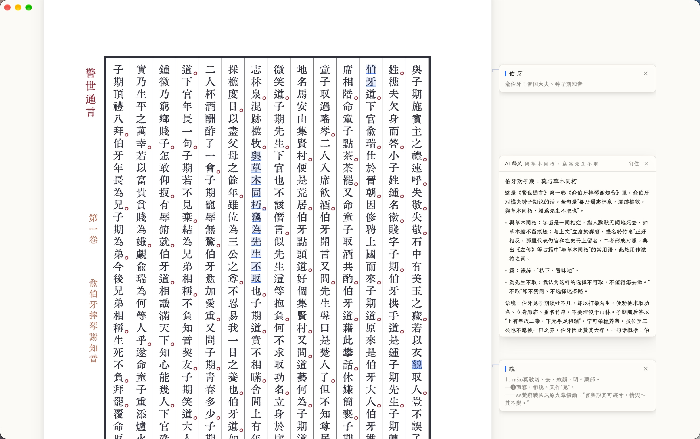

# 笺释 (gloss-pdf)

**笺释 (`gloss-pdf`)** 是一款基于 [GPUI](https://github.com/zed-industries/zed/tree/main/crates/gpui) 与 PDFium 构建的高性能桌面 PDF 阅读器，专为**古籍文献精读、即时辞书训诂与 AI 深度考据**打造。

它采用无边框沉浸界面与 GPU 瓦片渲染，将全部视觉重心留给书页本身；创新性地融合了**原生态页边笺注轨（Marginalia Rail）**、**AI 智能体上下文训诂**与**独立吸附式 MDX 词典浮窗**，双击页面字词或划选文句即可就地完成原版辞书与大模型考据，并支持一键「钉住」为随书批注。



---

## 核心特性

### 1. 原生页边笺注轨（Marginalia Rail）与随书钉住
- **原位对齐展开**：汲取古籍朱墨套印、行间夹注与眉批的阅读传统，在书页右侧开辟专属页边笺注栏。查词释义与 AI 考据直接锚定在目标文字行高位置就地展开，绝不遮挡正文。
- **一键「钉住」常驻**：遇到精辟释义或重要考据，点击卡片右上角「钉住」即可浓缩为紧凑笺注卡常驻页边。已钉住卡片折叠呈现核心标题，点击随时展开完整内容。
- **免二次查询，秒开恢复**：已钉住的词典与 AI 笺注与文字高亮一同存入文档同目录的旁路 `.highlights.json` 文件中，再次打开同一本文献时秒级重现，无需重新联网或查词。
- **选区交互胶囊**：双击直接选词；长按拖选长句或多字词松手后，在选区就近唤出精致的「词典 / AI」操作胶囊。胶囊支持 3 秒无操作渐隐（鼠标悬停暂停计时），并智能剔除古籍排版产生的字间误空格与大字距干扰。

### 2. AI 智能体深度训诂与上下文感知
针对古籍中辞书未收录的多字词、人名、生僻典故或难解文句，由大语言模型接力深度考据：
- **结构化三段式呈现**：
  - **【标题】**：16 字以内凝练概括，点明身份出处或文段主旨（折叠态直接显示标题，杜绝半句截断）；
  - **【内容】**：300 字以内精辟考据，支持 Markdown 渲染（粗体、行内代码、短列表，杜绝客套套话）；
  - **【原文】**：从当前页精准摘录包含该词或代表选区主旨的关键原句，带专属引用竖线沉浸呈现。
- **Agent 工具链主动取上下文**：基于 `ai-core`（轻量集成 rig 智能体运行时），模型自主决定是否调用上下文感知工具链：
  - `document_info`：识别书名与篇名上下文；
  - `current_page_text`：获取当前页完整文字层；
  - `surrounding_text`：定位划词前后的上下文语境；
  - `toc_nearest`：感知当前页所处的最近章节目录；
  - `read_page`：严格两页预算控制的跨页查阅，杜绝盲目翻页。
- **流式响应与工具透明化**：打字机式平滑流式吐字，工具调用以「名字 + 参数」单行轻量展示，支持生成中随时中断或失败重试。
- **多供应商与隐私分层**：支持 OpenAI（Responses API）、Anthropic（Messages API）以及任意兼容 OpenAI 协议的自定义端点（本地 Ollama / vLLM 或第三方中转服务）。API Key 仅保存在本地 `settings.json` 并掩码呈现，安全可控。

### 3. 便捷词典查询（MDX / MDD 原貌渲染）
- **原貌排版渲染**：内置 lightningcss 与 HTML 语义解析器，完美还原词典原版 HTML/CSS 样式与 `@font-face`（支持 WOFF/WOFF2 罕用字与古籍字库），《王力古汉语字典》《汉语大词典》等排版层次原汁原味。
- **多词典聚合管理**：支持添加、启停、拖拽排序多本 `.mdx` 词典，按设定顺序并行检索、聚合展示并清晰标注词典来源。
- **边缘吸附与独立浮窗**：词典亦可作为独立无边框浮窗运行，靠近主窗口左右边缘时自动磁吸贴合，并随主窗口移动或缩放同步跟随。
- **前缀联想与历史**：输入时跨词典实时提供前缀联想（160ms 防抖、大小写去重、最多 8 条），自动保存最近 50 条查词历史。

### 4. 纯粹的沉浸式书香阅读与书架
- **全新古籍书架首页**：卡片式书架陈列，配备侧边栏分类导航（全部文献、最近阅读、收藏等），支持按书名与路径实时搜索过滤。
- **真实页面渲染缩略图**：首页书架卡片直接呈现上次阅读停驻页的真实 PDF 渲染画面（非占位示意图），由独立后台 Worker 异步生成并落盘缓存，启动秒开丝滑不卡顿。
- **自适应纸张开本比例**：打开文档时根据页面真实几何长宽比自适应窗口尺寸，无论线装竖排、折页还是现代开本，均居中舒展，告别多余黑边。
- **自动隐身悬浮胶囊**：顶部操作栏与底部翻页缩放栏采用极简居中悬浮胶囊设计。鼠标移出感应区 1.5 秒后自动隐身，不遮挡正文与边注，也不拦截点击与滚轮；移动唤醒。
- **无边框极简设计 + 内置霞鹜文楷**：开箱即内嵌 **LXGW 文楷 TC**，沉浸式极简无边框设计（macOS 原生红黄绿交通灯，Windows 自绘极简控制），字体古雅温润。


### 5. 高性能渲染与安全批注
- **PDFium 运行库零配置自动托管**：首次打开 PDF 时自动检测系统平台与 CPU 架构，静默下载并安全缓存对应的 PDFium 动态链接库（macOS / Windows / Linux 均免去手动复制或配置环境变量的烦恼）。
- **GPU 瓦片渲染 + 元素层分离**：页面按 512×512 瓦片在独立工作线程渲染并上传为 GPUI 纹理，平移与缩放（范围 25%–400%）丝滑顺畅；文字选区、高亮、链接基于矢量字符坐标独立绘制，拼接零错位。
- **翻页优先调度与 256 MiB 智能预算**：渲染线程位图永远排在文字提取与全文搜索前面；快速翻页时滚出视口的积压瓦片自动作废，当前页始终最先出图；瓦片缓存超限按可视距离 LRU 淘汰。
- **抗干扰全文检索**：`Ctrl+F` / `⌘F` 全文检索自动滤除古籍排版中的字间空格、制表符与换行（例如检索「汉字」可精准匹配因版式排开的「汉 字」或跨行文句），支持实时扫描进度提示与跨页跳转。
- **安全旁路高亮批注**：选中文字按 `H` 快捷高亮，`Ctrl+S` / `⌘S` 保存为同名 `.highlights.json` 旁路文件，绝不破坏修改原始 PDF 文件的二进制内容。

---

## 快速上手

### 1. PDFium 动态库（通常无需手动准备）

程序运行依赖 PDFium 动态链接库，**首次打开 PDF 时会自动下载当前平台的预编译构建**，并安全缓存到用户数据目录（macOS 为 `~/Library/Application Support/gloss-pdf/pdfium/`，Windows 为 `%APPDATA%\gloss-pdf\pdfium\`），后续启动直接复用：

- **macOS / Linux / Windows**：本地无动态库时全自动下载匹配当前架构的版本；若遇网络受限，弹窗提示会给出明确错误原因及手动放置路径。
- 如需离线准备，可执行辅助脚本或手动把动态库放入项目根目录 / 可执行文件同级目录：
  ```bash
  bash scripts/setup-pdfium.sh
  ```
- 需要配置镜像或内网离线包时，可通过环境变量 `GLOSS_PDF_PDFIUM_URL` 指定下载链接（格式需与官方发布包相同的 `.tgz`）。

### 2. 编译与运行

```bash
# 启动到古籍书架首页
cargo run -p gloss-pdf

# 或直接打开指定 PDF 文件
cargo run -p gloss-pdf -- samples/dummy.pdf
```

> **提示**：首次编译 GPUI 依赖项耗时较长。运行时动态库查找顺序为：「可执行文件目录 → macOS Frameworks 目录 → 当前工作目录 → 用户数据目录（自动下载位置） → 系统/Homebrew 库目录」，全部未找到时方触发自动下载。
>
> 如需指定外部自定义字体，可将环境变量 `GLOSS_PDF_FONT_DIR` 指向包含 `LXGWWenKaiTC-Regular.ttf` 与 `LXGWWenKaiMonoTC-Regular.ttf` 的字体目录（重启生效）。

---

## 快捷键一览

| Windows / Linux | macOS | 功能说明 |
| :--- | :--- | :--- |
| `Ctrl+O` | `⌘O` | 打开 PDF 文件 |
| `Ctrl+B` | `⌘B` | 显示 / 隐藏目录大纲浮层 |
| `Ctrl+F` | `⌘F` | 首页过滤最近阅读；阅读器内开启全文检索 |
| `Ctrl+C` | `⌘C` | 复制选中文本（自动按行重整空格并过滤中文间空隙） |
| `H` | `H` | 将当前选区添加为高亮批注 |
| `Ctrl+S` | `⌘S` | 保存高亮批注与钉住的页边笺注到磁盘 |
| `Ctrl+H` | `⌘H` | 打开 / 关闭批注列表侧栏 |
| `Ctrl+Shift+D` | `⌘⇧D` | 显示 / 隐藏页边词典笺注卡 |
| `Ctrl+,` | `⌘,` | 打开 / 关闭应用设置面板 |
| `Ctrl+=` / `Ctrl+-` | `⌘=` / `⌘-` | 放大 / 缩小页面（步进 1%） |
| `Ctrl+滚轮` | `⌘+滚轮` | 以鼠标指针位置为锚点平滑缩放（范围 25%–400%） |
| `Ctrl+0` / `Ctrl+1` | `⌘0` / `⌘1` | 适页（整页可见） / 适宽（页面充满视口宽度） |
| `按住中键拖动` | `按住中键拖动` | 平移拖拽书页 |
| `点击底部页码` | `点击底部页码` | 输入目标页码后按 `Enter` 跳转，`Esc` 取消 |
| `PageDown` / `Space` | `PageDown` / `Space` | 向下平滑滚动一屏 |
| `PageUp` | `PageUp` | 向上平滑滚动一屏 |
| `Right` / `Left` | `Right` / `Left` | 下一页 / 上一页 |
| `Home` / `End` | `Home` / `End` | 跳转至首页 / 尾页 |
| `Ctrl+D` | `⌘D` | 切换深色 / 浅色书卷主题 |
| `Esc` | `Esc` | 优先收起选区胶囊，或关闭搜索/目录/设置面板，或清除选区 |
| `Ctrl+Q` | `⌘Q` | 保存进度并退出程序 |

---

## 打包分发与自动更新

项目支持 **Windows** 与 **macOS** 双端打包及应用内更新检查：
- **Windows**：通过 Inno Setup 生成 `gloss-pdf-<version>-setup.exe`（CI：`.github/workflows/windows.yml`）。
- **macOS**：生成 `gloss-pdf.app` 及 `.dmg` 镜像（CI：`.github/workflows/macos.yml`）。
- **应用内更新**：设置面板支持一键检查 GitHub Releases 最新正式版，下载对应平台安装包并启动安装。

### 本地手动打包

- **macOS**（产物输出至 `dist/` 目录）：
  ```bash
  bash installer/build-macos-app.sh
  ```
- **Windows**（需预装 Inno Setup 6）：
  ```powershell
  cargo build --release -p gloss-pdf
  & "C:\Program Files (x86)\Inno Setup 6\ISCC.exe" `
    "/DAPP_VERSION=0.1.7" "installer\gloss-pdf.iss"
  # 产物：dist\gloss-pdf-0.1.7-setup.exe
  ```

若直接分发免安装绿色便携包，请保留以下文件同目录：
```text
gloss-pdf.exe
pdfium.dll
THIRD_PARTY_NOTICES.md
third_party/                                           # PDFium 及其第三方组件许可
crates/gloss-pdf/assets/fonts/lxgw-wenkai-tc/OFL.txt   # 字体许可声明（SIL OFL 1.1）
```

---

## 数据与配置文件存储

笺释坚持「数据独立与零污染」原则，绝不篡改原始 PDF 文件，所有个人数据与批注均独立旁路存储：

| 数据内容 | 存储位置 | 说明 |
| :--- | :--- | :--- |
| **高亮与钉住笺注** | `<PDF同目录>/<文件名>.pdf.highlights.json` | 随文档旁路保存，记录稳定 ID、选区多边形、词条及已钉住的 AI / 辞书释义 |
| **最近阅读与进度** | `%APPDATA%\gloss-pdf\recent.json` | 记录历史路径、打开时间、停留页码、页内滚动比例与缩放适应模式 |
| **应用与 AI 设置** | `%APPDATA%\gloss-pdf\settings.json` | 主题、多词典启用顺序、AI 模型端点与 Key、自动更新开关、窗口几何 |
| **查词历史** | `%APPDATA%\gloss-pdf\dictionary_history.json` | 最近 50 条查询词（倒序去重） |
| **书架缩略图缓存** | `%APPDATA%\gloss-pdf\thumbnails\` | 首页书架卡片的真实页面渲染预览，按「文件+页码+修改时间」哈希缓存为 PNG |
| **PDFium 运行库** | `%APPDATA%\gloss-pdf\pdfium\` | 首次运行时自动下载并解压的动态链接库缓存 |

*(注：macOS 下用户数据目录为 `~/Library/Application Support/gloss-pdf`，Linux 下为 `~/.local/share/gloss-pdf`)*

---

## 项目架构与开发指南

工作区采用清晰的职责隔离架构，各核心 crate 解耦运行，保障了高性能与可维护性：

```text
Cargo.toml                 # Workspace 根配置（版本 0.1.7）
crates/
├── ai-core/               # AI 智能体与工具链引擎（独立轻量 crate）
│   └── src/
│       ├── agent.rs       # 训诂 Prompt 编排、流式三段式解析（标题/内容/原文）
│       ├── tools.rs       # 上下文工具定义（document_info, current_page_text, surrounding_text, toc_nearest, read_page）
│       ├── client.rs      # OpenAI Responses / Anthropic Messages / OpenAI 兼容端点抽象
│       └── settings.rs    # 供应商配置与模型功能绑定模型
├── pdf-core/              # PDF 核心引擎（独立线程驱动 PDFium，无 UI 依赖）
│   └── src/
│       ├── engine.rs      # 文档生命周期、512×512 瓦片渲染、文本/链接/大纲提取、忽略空白全文搜索
│       ├── thumbnail.rs   # 首页真实书页缩略图 Worker（独立线程与调度）
│       ├── pdfium_setup.rs# PDFium 动态链接库跨平台自动检测、校验与下载托管
│       ├── metadata.rs    # PDF 元数据解析与文件尾 /ModDate 兜底提取
│       └── model.rs       # 几何矩形 RectPt、字符盒 CharBox、大纲 Outline 基础类型
├── dict-core/             # MDX / MDD 辞书引擎（纯 Rust 解析，无 UI 依赖）
│   └── src/
│       ├── engine.rs      # 多词典并行加载、聚合查询、前缀联想、MDD 资源与外置样式/字体加载
│       ├── css.rs         # lightningcss 样式解析、选择器层叠与继承
│       ├── html.rs        # HTML 语义渲染树转换（段落、行内盒、表格、图片）
│       └── fonts.rs       # WOFF/WOFF2 古籍字库解包与 Unicode 码位覆盖检测
└── gloss-pdf/             # GPUI 桌面客户端主体（「笺释」应用）
    ├── assets/            # 内嵌 SVG 图标与 LXGW 文楷 TC 字体
    └── src/
        ├── main.rs        # 程序入口、日志、无边框原生窗口创建与按键映射
        ├── app.rs         # 全局状态装配与顶层 Render 入口
        ├── app/           # 控制器拆分（document / events / render / window / update）
        ├── ai_query.rs    # AI 训诂状态机、流式输出节流与内存缓存
        ├── ai_context.rs  # 跨线程向 PDF Worker 提取上下文工具数据的通道
        ├── viewer.rs      # 阅读器核心状态、瓦片预取与 256 MiB 内存淘汰管理
        ├── dictionary.rs  # 词典浮窗与页边笺注状态同步
        ├── thumbnails.rs  # 首页缩略图请求去重与磁盘/内存多级缓存
        ├── highlights.rs  # 旁路高亮与 PinnedGloss 钉住笺注的数据模型与持久化
        ├── layout.rs      # 纸张比例自适应、页边笺注轨（Marginalia Rail）槽位排版
        ├── selection.rs   # 文字选区、跨空格字符重构与智能去空格
        └── ui/            # GPUI 视图组件实现
            ├── ai_card.rs     # 页边 AI 释义卡片、流式状态与钉住交互
            ├── ai_markdown.rs # 高性能 Markdown 纯视图渲染器
            ├── dictionary.rs  # 页边笺注轨渲染与独立词典吸附窗口
            ├── home.rs        # 现代化古籍书架首页、真实缩略图网格
            ├── page.rs        # 页面瓦片拼接、选区覆盖层与「词典/AI」悬浮胶囊
            ├── chrome.rs      # 自动隐身浮动胶囊栏、窗口控制
            ├── outline.rs     # 目录大纲浮动抽屉
            └── settings.rs    # 多词典管理、AI 供应商/模型配置与应用偏好
```

更详细的设计说明请参阅：
- **架构设计与模块契约**：[docs/architecture.md](docs/architecture.md)
- **MDX 辞书样式支持规范**：[docs/dictionary.md](docs/dictionary.md)
- **功能路线图与待办列表**：[docs/todo.md](docs/todo.md)

### 运行单元测试

```powershell
cargo test --workspace --locked
```

---

## 开源许可与致谢

本项目以 **MIT OR Apache-2.0** 双许可发布（详见 [LICENSE-MIT](LICENSE-MIT) 与 [LICENSE-APACHE](LICENSE-APACHE)）。

核心第三方组件与字体许可：
- **GPUI** (`zed-industries/zed`)：Apache-2.0
- **PDFium** & **pdfium-render**：BSD-3-Clause / MIT OR Apache-2.0
- **LXGW 文楷 TC**（界面内嵌字体）：SIL Open Font License 1.1
- 完整第三方许可声明详见 [THIRD_PARTY_NOTICES.md](THIRD_PARTY_NOTICES.md) 与 `third_party/pdfium/`。
