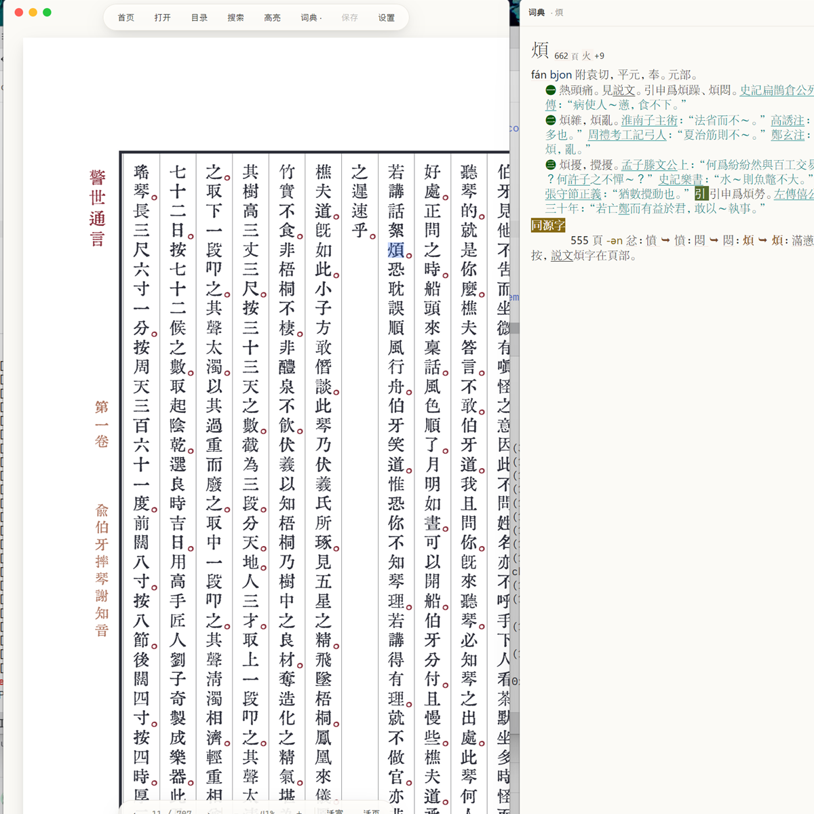
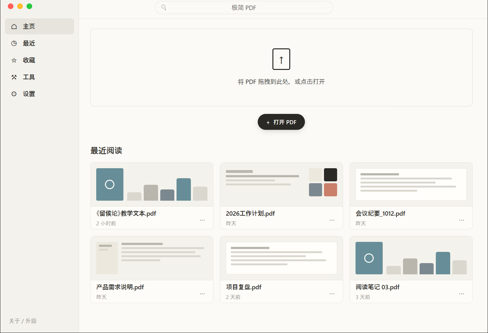

# gpui-pdf

用 [GPUI](https://github.com/zed-industries/zed/tree/main/crates/gpui) 写的 PDF 阅读器：页面用 GPU 渲染，文字、链接、目录、搜索、高亮走 **PDF 元素层**，不是截图画布。

无边框窗口 + 全浮层控件，界面里只留页面本身。查词用独立的无边框词典窗口：按 MDX 自带的 HTML/CSS 渲染释义，拖到主窗口边缘会自动吸附，不挡页面。



## 界面

- **首页**：左侧导航 + 顶部搜索 + 拖拽打开区 + 「最近阅读」网格；最近打开的文件和阅读位置都会持久化
- **没有 Windows 原生标题栏**：左上角自绘红黄绿窗口按钮，顶部 46px 透明拖拽区
- 打开文档后切换为阅读器：顶部居中一颗浮动胶囊（首页、打开、目录、搜索、高亮、保存、主题）
- 底部居中浮动胶囊：上一页 / 页码 / 下一页 / 缩放 / 适宽 / 适页；点击页码可直接输入跳转
- 两颗胶囊会自动隐身：鼠标离开顶部/底部感应带 1.5 秒后隐藏（应用刚启动、鼠标还没动过时一直显示），鼠标回到该区域立刻出现；缩放、翻页、切换适应模式、开关面板、保存高亮等参数变化也会把它叫回来（隐身时不拦截页面的点击、滚轮、拖选与中键平移）
- 目录和搜索都是浮层，按需出现
- **词典是独立窗口**：同样没有系统标题栏，顶部一条自绘窄标题栏；窗口可自由拖动，靠近主窗口边缘时自动吸附贴合，不遮挡 PDF 页面，吸附后跟着主窗口一起移动（主窗口移动、改变大小都不会把词典窗口落下；拖远了就不再跟随）。可同时启用多本 MDX 词典，查询结果按设置顺序聚合并标注来源
- 拖动窗口：首页顶部整条（搜索框和窗口按钮除外）都可拖动；阅读器顶部 46px（浮动胶囊除外）也可拖动，可拖动区域显示手型光标。双击顶部可最大化。
- 关闭文档或点胶囊里的「首页」回到首页



## 功能

- **页面渲染**：PDFium 按 512×512 瓦片渲染成位图 → GPUI 纹理，只请求与视口相交的瓦片；缩放/适宽/适页即时重渲染（独立工作线程，UI 不卡）
- **内存预算**：瓦片位图缓存默认上限 256 MiB，超限时先淘汰离可视区域最远的页/瓦片；400% 放大浏览多页时内存不会随页数线性增长
- **跳页**：点击底部页码出现输入框，`Enter` 跳转并夹取到 1..总页数，`Esc` 取消；输入框聚焦时不会误触阅读快捷键
- **整页适应**：打开文档默认按整页显示，宽高同时适应；窗口尺寸变化时自动重新计算（手动缩放后不再跟随）
- **按纸张选窗口**：打开文档时按页面比例调整窗口大小，横版/竖版 PDF 都不会在两侧或上下留出大片空白
- **文档信息**：读取并展示 PDF 的标题、作者、主题、关键词、创建者、生成器、创建时间与修改时间；窗口标题和最近阅读优先使用标题，缺失时回退文件名
- **首页与最近阅读**：拖拽 PDF 到窗口任意位置即可打开；最近阅读按时间倒序持久化，支持搜索过滤、复制路径、移除记录；卡片显示上次读到的页码与百分比
- **阅读进度**：页码、页内滚动位置、缩放（或适宽/适页模式）按文件保存，下次打开同一个 PDF 自动恢复；切页、缩放、滚动和退出时都会落盘
- **窗口几何**：主窗口的大小、屏幕位置与最大化状态存在 `settings.json`，下次启动原样恢复；换了显示器或拔掉副屏时按当前工作区夹回来，不会把窗口开到看不见的地方
- **文本选择**：鼠标拖选、双击选词、`Ctrl+C` 复制（按行重建换行与空格）
- **全文搜索**：`Ctrl+F` 输入关键词（支持中文输入法），本页全部匹配高亮，同时统计全文命中；
  查询串与文本层里的空格、换行等空白一律忽略（「汉 字」「T 细胞」都能命中），
  `Enter` / `Shift+Enter` 在全文匹配中前后跳转，跨页时直接翻到目标页并定位到那一处
- **文本输入**：搜索框和词典输入框都是自研的单行输入组件（`EntityInputHandler`），支持
  输入法组合输入、选区、`Ctrl+A/C/X/V`、鼠标点选与横向滚动
- **链接跳转**：识别 URI 链接与页内跳转链接，悬停变手型，点击打开/跳页
- **目录导航**：浮动目录面板，读取 PDF 书签树
- **高亮批注**：选中文字按 `H` 加高亮，`Ctrl+S` 保存；存在 PDF 旁边的 sidecar JSON，下次打开自动恢复。
  `Ctrl+H` 打开批注侧栏：按页列出高亮、点击跳页、右侧 ✕ 删除（删除会立即写盘）
- **词典查词**：双击 PDF 中的字词，或直接在词典窗口里输入（支持中文输入法）后回车，
  在独立的无边框词典窗口里按 MDX 自带的 HTML/CSS 渲染释义。设置中可添加/移除/排序/启停多本 MDX，
  查询按顺序聚合且每条释义标注来源；输入时给出来自各词典的前缀联想（去重、最多 8 条），
  查词历史持久化、倒序去重、上限 50 条，可点击重查或一键清空
- **缩放/主题**：`Ctrl+=` / `Ctrl+-` 每次 1% 缩放，`Ctrl+0` 适页，`Ctrl+1` 适宽；`Ctrl+滚轮` 以指针下的页面点为锚缩放（每行 1%，一格约 3%，范围 25%–400%），普通滚轮仍只滚动；按住鼠标中键（滚轮键）拖动可缓慢上下平移页面；`Ctrl+D` 深/浅色切换

## 运行

```powershell
cargo run -p gpui-pdf
# 或直接打开一个文件
cargo run -p gpui-pdf -- samples/dummy.pdf
```

首次编译 GPUI 较慢。`pdfium.dll`（约 7.5 MB）已放在项目根目录，运行时按
「exe 目录 → 当前目录 → 系统库」顺序查找。

界面默认使用 **LXGW 文楷 TC**。字体文件在
`crates/gpui-pdf/assets/fonts/lxgw-wenkai-tc/`，编译时直接嵌进二进制，
分发的 exe 自带字体，不再依赖本机的下载目录。需要换字体版本时，把
`GPUI_PDF_FONT_DIR` 指向包含 `LXGWWenKaiTC-Regular.ttf` 和
`LXGWWenKaiMonoTC-Regular.ttf` 的目录即可（重启生效）；目录不完整或读取失败时
使用内置字体，内置字体也注册失败时回退到系统字体。

字体以 SIL Open Font License 1.1 分发，许可文本在字体同目录的 `OFL.txt`。

## 分发与自动更新

Windows 安装包由 Inno Setup 生成，脚本在 `installer/gpui-pdf.iss`；CI 在
`.github/workflows/windows.yml`，推 tag 时自动打包并发布到 GitHub Releases。

发布一个新版本：

```powershell
# 1. 改 Cargo.toml 里的 [workspace.package] version（CI 会校验 tag 与它一致）
# 2. 提交后打 tag 并推送
git tag v0.1.1
git push origin main --tags
```

CI 会编译 release、生成 `gpui-pdf-0.1.1-setup.exe`，并作为 release 资产上传。
普通 push 与 PR 只上传构建产物（artifact），不发 release。

release 构建关闭 debug 信息，并启用 fat LTO、单 codegen unit、`panic = "abort"` 与
`strip = true`，在保证功能不变的前提下明显缩小 exe。

安装包安装到当前用户的 `%LOCALAPPDATA%\Programs\gpui-pdf`，不触发 UAC；
`pdfium.dll` 与 exe 放在同一目录，运行时按「exe 目录 → 当前目录 → 系统库」
顺序查找。

**应用内更新**：设置面板的「更新」区块会调用 GitHub API 读取最新正式版
（跳过带 `-` 的预发布），发现新版本后用 `self_update` 下载安装包，再以
`/SILENT` 运行安装器并退出应用。仓库坐标在 CI 构建时由 `GITHUB_REPOSITORY`
注入，本地构建回落到 `shanaiardor/gpui-pdf`。启动 4 秒后自动检查（发布构建
才启用），可以在设置里关掉。

本地手工打包（需要装 Inno Setup 6）：

```powershell
cargo build --release -p gpui-pdf
& "C:\Program Files (x86)\Inno Setup 6\ISCC.exe" `
  "/DAPP_VERSION=0.1.1" "installer\gpui-pdf.iss"
# 输出：dist\gpui-pdf-0.1.1-setup.exe
```

不放安装包、直接发绿包时，需要带上：

```
gpui-pdf.exe
pdfium.dll
THIRD_PARTY_NOTICES.md
third_party/                        # PDFium 及其第三方许可
crates/gpui-pdf/assets/fonts/lxgw-wenkai-tc/OFL.txt   # 字体许可（OFL 要求）
```

字体已经嵌进 exe，不需要再带 `fonts/` 目录；`pdfium.dll` 仍必须与 exe 同目录。

## 快捷键

| 快捷键 | 行为 |
|---|---|
| `Ctrl+O` | 打开 PDF |
| `Ctrl+B` | 显示 / 隐藏目录浮层 |
| `Ctrl+F` | 首页筛选最近阅读（`Enter` 打开第一条，`Esc` 清空）；阅读器内全文搜索（`Enter` 下一个，`Shift+Enter` 上一个，`Esc` 关闭） |
| `Ctrl+C` | 复制选中文本 |
| `Ctrl+S` | 保存高亮 |
| `Ctrl+H` | 批注侧栏（高亮列表，可跳转/删除） |
| `Ctrl+=` / `Ctrl+-` | 放大 / 缩小（每次 1%） |
| `Ctrl+滚轮` | 以指针位置为锚缩放（每行 1%，一格约 3%；25%–400%） |
| 按住中键拖动 | 上下（含左右）拖动阅读，半速跟随指针 |
| 点击底部页码 | 输入页码后 `Enter` 跳转，`Esc` 取消 |
| `Ctrl+0` / `Ctrl+1` | 适页（整页可见） / 适宽 |
| `Ctrl+D` | 切换深色/浅色 |
| `PageDown` / `PageUp` | 下一页 / 上一页 |
| `Home` / `End` | 第一页 / 最后一页 |
| `H` | 把当前选区加为高亮 |
| `Esc` | 关闭搜索 / 目录，或清除选区 |

## 结构

```
Cargo.toml                 # workspace
crates/
├── pdf-core/              # PDF 引擎（不依赖 UI，可单独测试）
│   └── src/
│       ├── engine.rs      # PDFium worker：打开、瓦片渲染、文本/链接/目录提取、全文搜索
│       ├── metadata.rs    # 兜底读取 /ModDate 等文件尾元数据
│       └── model.rs       # RectPt / CharBox / Link / Outline / PageHits / DocumentMetadata
├── dict-core/             # MDX 词典引擎（不依赖 UI）
│   └── src/engine.rs      # 多词典加载、聚合查询、前缀联想、MDD/CSS/字体
└── gpui-pdf/              # GPUI 应用
    ├── assets/
    │   ├── icons/         # 内嵌 SVG 图标
    │   └── fonts/lxgw-wenkai-tc/  # 文楷常规体/等宽体 + OFL.txt
    └── src/
        ├── main.rs        # 入口：日志、无边框窗口、命令行参数
        ├── assets.rs      # 内嵌静态资源
        ├── fonts.rs       # 内嵌 LXGW 文楷，GPUI_PDF_FONT_DIR 可覆盖
        ├── app.rs         # 控制器：状态容器、订阅、顶层 Render
        ├── app/update.rs  # 更新状态机：检查/下载/启动安装器
        ├── update.rs      # GitHub Releases 检查与下载（self_update）
        ├── layout.rs      # 适宽/适页缩放、页边距、按纸张选择窗口尺寸、锚点换算
        ├── window_layout.rs # 浮窗吸附与主窗口几何恢复（纯计算）
        ├── window_move.rs  # 调 SetWindowPos 移动无边框浮窗（专用线程，避免重入借 App）
        ├── tiles.rs       # 512×512 瓦片网格与可视瓦片计算
        ├── home.rs        # 首页状态：最近阅读持久化、搜索过滤、侧栏选中项
        ├── settings.rs    # 设置读写：主题、多词典列表、自动更新、窗口几何
        ├── dictionary.rs  # 词典窗口状态：多词典、历史、联想、查询结果
        ├── dict_history.rs # 查词历史持久化（JSON，上限 50）
        ├── dict_suggest.rs # 联想去重/限长/防抖常量
        ├── progress.rs    # 阅读进度模型：页码/页内滚动/缩放/适应模式
        ├── viewer.rs      # 阅读器状态：文档/页/瓦片缓存/缩放/滚动/内存预算
        ├── selection.rs   # 选区、文本重建、双击选词
        ├── search.rs      # 搜索状态：本页匹配 + 全文命中 + 跨页跳转
        ├── highlights.rs  # 高亮 + sidecar JSON（稳定 id、可删除）
        ├── geometry.rs    # 矩形合并等纯函数
        ├── theme.rs       # 配色与字体
        └── ui/            # 纯呈现层
            ├── home.rs    # 首页：侧栏、搜索、拖拽区、最近阅读卡片
            ├── chrome.rs  # 顶部/底部胶囊、页码输入、窗口按钮、拖拽条
            ├── page.rs    # 滚动容器、瓦片页面、覆盖层
            ├── outline.rs # 目录浮层
            ├── annotations.rs # 批注侧栏：高亮列表、跳转、删除
            ├── text_input.rs  # 单行输入框：EntityInputHandler + 自定义 Element
            ├── search_bar.rs
            ├── settings.rs    # 设置面板：文档信息、多词典、更新
            ├── dictionary.rs  # 独立词典窗口：释义、历史、联想
            ├── toast.rs
            └── empty.rs
pdfium.dll                 # PDFium 动态库（运行时绑定）
installer/gpui-pdf.iss     # Inno Setup 安装包定义
.github/workflows/         # GitHub Actions：测试、打包、发布 release
samples/                   # 测试用 PDF（dummy.pdf / colors.pdf）
```

分层与“新功能该改哪里”见 [docs/architecture.md](docs/architecture.md)，待办与优先级见
[docs/todo.md](docs/todo.md)。

测试：

```powershell
cargo test --workspace --locked
```

当前基线：`gpui-pdf` 128 项通过（另 1 项联网测试忽略）、`dict-core` 50 项通过
（另 1 项真实词典测试忽略）、`pdf-core` 15 项通过。

手动验证文本选择：`cargo run -p gpui-pdf -- samples/dummy.pdf`，拖选或双击选词后松开鼠标，
终端会打印页号、字符索引区间、字符数和选区文本（`Ctrl+C` 复制时同样打印），方便对照
屏幕上选中的内容。

关键设计：

- **PDFium 关在独立线程**：`PdfDocument` 生命周期绑定 `Pdfium`，所以 PDFium 被 leak 成
  `'static`，文档只在工作线程里；UI 通过 channel 收 `Opened` / `RenderedTile` / `PageElements` 事件。
- **图片层 + 元素层**：位图只负责显示；字符包围盒（`tight_bounds`）与链接矩形单独保存，
  用于命中测试和覆盖层绘制。大页面按 512×512 瓦片渲染，覆盖层仍使用整页坐标，
  因此文本选择、链接、搜索高亮与高亮批注在瓦片拼接后不会错位。
- **颜色通道**：GPUI `RenderImage` 的缓冲区是 **BGRA**。渲染时对 Pdfium 关闭字节序反转
  （`.set_reverse_byte_order(false)`）并直接取 `as_raw_bytes()`；若用 `as_rgba_bytes()`，
  红蓝通道会互换。
- **坐标统一**：PDF 是 pt、原点左下、y 向上；GPUI 是 px、原点左上、y 向下。
  换算只有一处：`screen = (pdf_point - origin) * zoom`，y 轴翻转。
- **整页适应与窗口**：适页缩放取 `min(宽比, 高比)`；打开文档时按纸张比例把窗口
  调整到工作区内的大小（不会越出屏幕），之后窗口尺寸变化会按当前适宽/适页模式重算。
  手动缩放会退出适应模式，不再跟随窗口变化。
- **无边框窗口**：`TitlebarOptions { appears_transparent: true }` 隐藏系统标题栏；
  顶部拖拽区与左上角窗口按钮用 GPUI 的 `WindowControlArea::Drag/Min/Max/Close`，
  交给 Windows 原生命中测试处理，所以拖动、最大化、关闭都是系统行为。
- **词典窗口吸附**：GPUI 没有公开的“移动窗口”接口。Windows 下用 `raw-window-handle`
  取 HWND 后调 `SetWindowPos`，鼠标拖拽由 `on_drag_move` 驱动；初始摆位和吸附是纯几何
  计算（`window_layout.rs`），靠近主窗口或工作区边缘 24px 时贴成 0 间距，最后夹进工作区。
  主窗口的 `observe_window_bounds` 通知里先调 `follow_dictionary_window`：有锚点（`Anchor`：
  贴哪边 / 水平间距 / 竖直偏移）就用 `Anchor::place` 重新贴边并夹进工作区，所以拖主窗口、
  按纸张比例改大小、最大化时词典窗口都跟着走；浮窗被工作区边缘夹住时锚点不变，主窗口
  移回来浮窗就回到原位。锚点只在两处变：创建浮窗时按当时几何推导，用户拖动浮窗后由它
  通过 `DictRequest::FloatPlaced` 把新位置报给主窗口重算——拖远了自然就不再跟随，拖回来
  又恢复。`SetWindowPos` 放在专用线程（`window_move.rs`）里调用：它会给目标窗口同步投递
  `WM_MOVE`，而在主窗口的 bounds 回调里直接调会让浮窗的 `bounds_changed` 再借一次 `App`
  （`RefCell already borrowed`），窗口内部状态跟着失真。换线程后 `WM_MOVE` 只能等窗口线程
  自己取消息时才处理，那时借用已经释放；`cx.defer` / `cx.spawn` 解决不了这个问题——延迟
  效果和前台任务同样是拿着 `&mut App` 执行闭包的。队列只留最后一次请求，拖动时不会积压。
  同一份纯几何也负责主窗口几何的恢复：`best_work_area` 在多块屏里挑重叠最多的工作区，
  `restore_window_bounds` 决定原位保留还是居中，并夹进工作区。其他平台继续用系统原生标题栏拖拽。
- **覆盖层用绝对定位 div**：选区/搜索/高亮用半透明矩形，链接用透明热区；
  文字量不大时比自绘 Element 简单，后续要优化可换成自定义 `Element::paint`。
- **输入框走平台输入通道**：`ui/text_input.rs` 实现 `EntityInputHandler`，在自定义
  `Element::paint` 里调 `window.handle_input(...)` 把 `ElementInputHandler` 交给窗口，
  中文输入法的组合输入由 `replace_and_mark_text_in_range` 落到 `TextField`，绘制时给
  组合段画下划线。编辑键（Backspace / 方向键 / 剪切复制粘贴）绑在 `TextInput` 上下文里，
  只有输入框聚焦时生效，不会抢走阅读器的 PageDown / H。
- **全文搜索在 worker 里做**：worker 按页缓存 `page.text().all()` 的纯文本，只回
  「每页命中数」；UI 用这些计数把全局序号换算成「第几页第几个匹配」，跳页后等页面
  字符数据回来，再定位到页内第 N 个匹配并高亮。

## 数据文件

高亮保存为与 PDF 同名的 sidecar：

```
samples/dummy.pdf
samples/dummy.pdf.highlights.json
```

最近阅读（含阅读进度）保存在用户数据目录：

```
%APPDATA%\gpui-pdf\recent.json
```

只记录路径、文件名、打开时间，以及上次读到的页码、页内滚动比例、缩放和适应模式，不复制 PDF；
文件被移动或删除后会在下次启动时自动清理。旧版本没有进度字段的记录仍可直接读取；
旧版本进度里没有适应模式，会按适页打开一次，之后手动缩放会记录为 `free` 并照常恢复。
如果文件被替换成页数不同的版本，会放弃旧页码、从头打开，避免跳到错误位置。

设置与查词历史也放在同一目录：

```
%APPDATA%\gpui-pdf\settings.json
%APPDATA%\gpui-pdf\dictionary_history.json
```

`settings.json` 内保存多词典列表（路径、启用状态、顺序）。旧版本的单本 `dictionary_path`
会在读取时自动迁移成一条启用记录，迁移后继续按新格式保存；词典历史与最近阅读一样做容错读取，
文件损坏时从空历史开始，不影响启动。

不修改原始 PDF。原因见「已知限制」。

每条高亮带一个稳定的 `id` 和高亮时的选中文字，批注侧栏用它做列表和删除；旧版本只写
`page` / `rects` 的文件仍可直接读取，加载时会自动补上 `id`。

## 已知限制 / 下一步

- **全文搜索要先把每页文本过一遍**：第一次搜某个文档时 worker 会逐页调 PDFium 提取文本，
  大文档开头会有几秒延迟（之后按页缓存在 worker 里，改关键词只重算字符串匹配）。
  搜索期间搜索框显示「已扫描 N/M 页」，结果返回后显示命中数。
- **高亮没有写进 PDF 标准注释**：PDFium 的公开 C API 不提供 `FPDFAnnot_GenerateAppearance`，
  手工创建的 Highlight 注释缺少 `/AP` 外观流，其他阅读器不一定渲染。因此先用 sidecar 持久化；
  后续可以自己生成 `/AP` Form XObject。
- **批注只有高亮一种**：下划线、便签、备注文字还没做；侧栏也没有编辑/搜索。
- **最近阅读缩略图是占位排版**：没有读取 PDF 首页生成真实缩略图，卡片里的图形只是按路径稳定选择的示意图。
- **瓦片缓存按位图字节计**：默认预算 256 MiB；若视口大到连可见瓦片都放不下，会优先保住可见瓦片、暂时超出预算，而不是显示空白。
- **未做页面旋转与双页并排**：目前固定竖排单页连续滚动。
- **自动调窗口不改变窗口位置**：GPUI 只暴露了改尺寸的接口；窗口靠屏幕下方时会按剩余空间缩小，避免伸出屏幕。
- **未做表单字段**：PDFium 能渲染 widget，但填写/保存还没接。

## 依赖与许可

- `gpui` / `gpui_platform`：锁定 Zed `4bd19937`，Apache-2.0
- `pdfium-render` 0.9.4：MIT OR Apache-2.0
- `self_update` 1.3（GitHub Releases 检查与下载，底层 `ureq` + `rustls`）：MIT
- PDFium（`pdfium.dll`）：BSD-3-Clause，另含 freetype / harfbuzz / icu 等第三方组件
- LXGW 文楷 TC（界面字体，已嵌入二进制）：SIL Open Font License 1.1
- 其他：`image`、`serde`、`serde_json`、`futures`、`anyhow`、`log`、`env_logger`、`unicode-segmentation`

本项目以 **MIT OR Apache-2.0** 发布：MIT 见 `LICENSE` / `LICENSE-MIT`，Apache-2.0 见 `LICENSE-APACHE`。
随仓库分发的 `pdfium.dll` 及其第三方许可文本在 `third_party/pdfium/`，
完整清单见 [THIRD_PARTY_NOTICES.md](THIRD_PARTY_NOTICES.md)。
