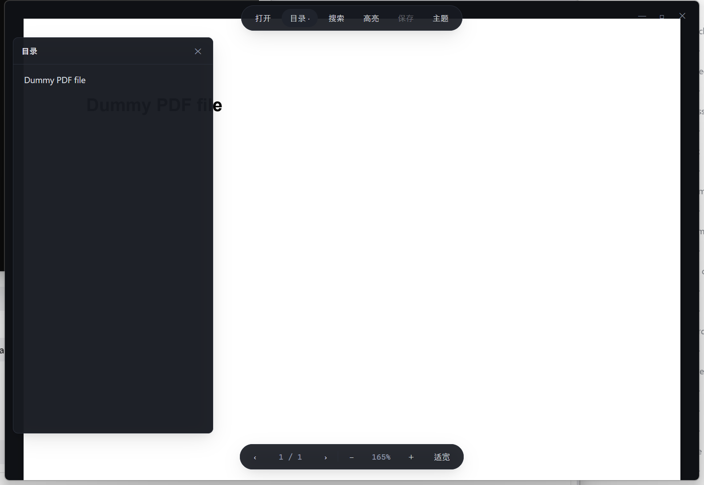

# gpui-pdf

用 [GPUI](https://github.com/zed-industries/zed/tree/main/crates/gpui) 写的 PDF 阅读器：页面用 GPU 渲染，文字、链接、目录、搜索、高亮走 **PDF 元素层**，不是截图画布。

无边框窗口 + 全浮层控件，界面里只留页面本身。



## 界面

- **首页**：左侧导航 + 顶部搜索 + 拖拽打开区 + 「最近阅读」网格；最近打开的文件和阅读位置都会持久化
- **没有 Windows 原生标题栏**：左上角自绘红黄绿窗口按钮，顶部 46px 透明拖拽区
- 打开文档后切换为阅读器：顶部居中一颗浮动胶囊（首页、打开、目录、搜索、高亮、保存、主题）
- 底部居中浮动胶囊：上一页 / 页码 / 下一页 / 缩放 / 适宽 / 适页
- 目录和搜索都是浮层，按需出现
- 拖动窗口：首页顶部整条（搜索框和窗口按钮除外）都可拖动；阅读器顶部 46px（浮动胶囊除外）也可拖动，可拖动区域显示手型光标。双击顶部可最大化。
- 关闭文档或点胶囊里的「首页」回到首页


## 功能

- **页面渲染**：PDFium 渲染成位图 → GPUI 纹理，缩放/适宽/适页即时重渲染（独立工作线程，UI 不卡）
- **整页适应**：打开文档默认按整页显示，宽高同时适应；窗口尺寸变化时自动重新计算（手动缩放后不再跟随）
- **按纸张选窗口**：打开文档时按页面比例调整窗口大小，横版/竖版 PDF 都不会在两侧或上下留出大片空白
- **首页与最近阅读**：拖拽 PDF 到窗口任意位置即可打开；最近阅读按时间倒序持久化，支持搜索过滤、复制路径、移除记录；卡片显示上次读到的页码与百分比
- **阅读进度**：页码、页内滚动位置、缩放（或适宽/适页模式）按文件保存，下次打开同一个 PDF 自动恢复；切页、缩放、滚动和退出时都会落盘
- **文本选择**：鼠标拖选、双击选词、`Ctrl+C` 复制（按行重建换行与空格）
- **全文搜索**：`Ctrl+F` 输入关键词，本页全部匹配高亮，`Enter` / `Shift+Enter` 切换
- **链接跳转**：识别 URI 链接与页内跳转链接，悬停变手型，点击打开/跳页
- **目录导航**：浮动目录面板，读取 PDF 书签树
- **高亮批注**：选中文字按 `H` 加高亮，`Ctrl+S` 保存；存在 PDF 旁边的 sidecar JSON，下次打开自动恢复
- **缩放/主题**：`Ctrl+=` / `Ctrl+-` 缩放，`Ctrl+0` 适页，`Ctrl+1` 适宽；`Ctrl+D` 深/浅色切换

## 运行

```powershell
cargo run -p gpui-pdf
# 或直接打开一个文件
cargo run -p gpui-pdf -- samples/dummy.pdf
```

首次编译 GPUI 较慢。`pdfium.dll`（约 7.5 MB）已放在项目根目录，运行时按
「exe 目录 → 当前目录 → 系统库」顺序查找。

## 快捷键

| 快捷键 | 行为 |
|---|---|
| `Ctrl+O` | 打开 PDF |
| `Ctrl+B` | 显示 / 隐藏目录浮层 |
| `Ctrl+F` | 首页筛选最近阅读（`Enter` 打开第一条，`Esc` 清空）；阅读器内搜索（`Enter` 下一个，`Shift+Enter` 上一个，`Esc` 关闭） |
| `Ctrl+C` | 复制选中文本 |
| `Ctrl+S` | 保存高亮 |
| `Ctrl+=` / `Ctrl+-` | 放大 / 缩小 |
| `Ctrl+0` / `Ctrl+1` | 适页（整页可见） / 适宽 |
| `Ctrl+D` | 切换深色/浅色 |
| `PageDown` / `PageUp` | 下一页 / 上一页 |
| `Home` / `End` | 第一页 / 最后一页 |
| `H` | 把当前选区加为高亮 |
| `Esc` | 关闭搜索 / 目录，或清除选区 |

## 结构

```
Cargo.toml                 # workspace
crates/
├── pdf-core/              # PDF 引擎（不依赖 UI，可单独测试）
│   └── src/
│       ├── engine.rs      # PDFium worker：打开、渲染、文本/链接/目录提取
│       └── model.rs       # RectPt / CharBox / Link / Outline
└── gpui-pdf/              # GPUI 应用
    └── src/
        ├── main.rs        # 入口：日志、无边框窗口、命令行参数
        ├── app.rs         # 控制器：引擎事件、键盘/鼠标、生命周期
        ├── layout.rs      # 适宽/适页缩放、页边距、按纸张选择窗口尺寸
        ├── home.rs        # 首页状态：最近阅读持久化、搜索过滤、侧栏选中项
        ├── progress.rs    # 阅读进度模型：页码/页内滚动/缩放/适应模式
        ├── viewer.rs      # 阅读器状态：文档/页/缩放/滚动/页面缓存
        ├── selection.rs   # 选区、文本重建、双击选词
        ├── search.rs      # 页内搜索
        ├── highlights.rs  # 高亮 + sidecar JSON
        ├── geometry.rs    # 矩形合并等纯函数
        ├── theme.rs       # 配色与字体
        └── ui/            # 纯呈现层
            ├── home.rs    # 首页：侧栏、搜索、拖拽区、最近阅读卡片
            ├── chrome.rs  # 顶部/底部胶囊、窗口按钮、拖拽条
            ├── page.rs    # 滚动容器、页面、覆盖层
            ├── outline.rs # 目录浮层
            ├── search_bar.rs
            ├── toast.rs
            └── empty.rs
pdfium.dll                 # PDFium 动态库（运行时绑定）
samples/                   # 测试用 PDF（dummy.pdf / colors.pdf）
```

分层与“新功能该改哪里”见 [docs/architecture.md](docs/architecture.md)。

测试：

```powershell
cargo test -p gpui-pdf
```

手动验证文本选择：`cargo run -p gpui-pdf -- samples/dummy.pdf`，拖选或双击选词后松开鼠标，
终端会打印页号、字符索引区间、字符数和选区文本（`Ctrl+C` 复制时同样打印），方便对照
屏幕上选中的内容。

关键设计：

- **PDFium 关在独立线程**：`PdfDocument` 生命周期绑定 `Pdfium`，所以 PDFium 被 leak 成
  `'static`，文档只在工作线程里；UI 通过 channel 收 `Opened` / `Rendered` 事件。
- **图片层 + 元素层**：位图只负责显示；字符包围盒（`tight_bounds`）与链接矩形单独保存，
  用于命中测试和覆盖层绘制。
- **颜色通道**：GPUI `RenderImage` 的缓冲区是 **BGRA**。渲染时对 Pdfium 关闭字节序反转
  （`.set_reverse_byte_order(false)`）并直接取 `as_raw_bytes()`；若用 `as_rgba_bytes()`，
  红蓝通道会互换。
- **坐标统一**：PDF 是 pt、原点左下、y 向上；GPUI 是 px、原点左上、y 向下。
  换算只有一处：`screen = (pdf_point - origin) * zoom`，y 轴翻转。
- **整页适应与窗口**：适页缩放取 `min(宽比, 高比)`；打开文档时按纸张比例把窗口
  调整到工作区内的大小（不会越出屏幕），之后窗口尺寸变化会按当前适宽/适页模式重算。
  手动缩放会退出适应模式，不再跟随窗口变化。
- **无边框窗口**：`TitlebarOptions { appears_transparent: true }` 隐藏系统标题栏；
  顶部拖拽区与左上角窗口按钮用 GPUI 的 `WindowControlArea::Drag/Min/Max/Close`，
  交给 Windows 原生命中测试处理，所以拖动、最大化、关闭都是系统行为。
- **覆盖层用绝对定位 div**：选区/搜索/高亮用半透明矩形，链接用透明热区；
  文字量不大时比自绘 Element 简单，后续要优化可换成自定义 `Element::paint`。

## 数据文件

高亮保存为与 PDF 同名的 sidecar：

```
samples/dummy.pdf
samples/dummy.pdf.highlights.json
```

最近阅读（含阅读进度）保存在用户数据目录：

```
%APPDATA%\gpui-pdf\recent.json
```

只记录路径、文件名、打开时间，以及上次读到的页码、页内滚动比例、缩放和适应模式，不复制 PDF；
文件被移动或删除后会在下次启动时自动清理。旧版本没有进度字段的记录仍可直接读取；
旧版本进度里没有适应模式，会按适页打开一次，之后手动缩放会记录为 `free` 并照常恢复。
如果文件被替换成页数不同的版本，会放弃旧页码、从头打开，避免跳到错误位置。

不修改原始 PDF。原因见「已知限制」。

## 已知限制 / 下一步

- **搜索框不支持输入法**：现在用 `on_key_down` 的 `key_char` 收集字符，中文 IME 组合输入
  收不到；需要换成 `EntityInputHandler` 文本输入组件。
- **高亮没有写进 PDF 标准注释**：PDFium 的公开 C API 不提供 `FPDFAnnot_GenerateAppearance`，
  手工创建的 Highlight 注释缺少 `/AP` 外观流，其他阅读器不一定渲染。因此先用 sidecar 持久化；
  后续可以自己生成 `/AP` Form XObject。
- **单页视图**：一次显示一页，页内可滚动；没有连续多页滚动、缩略图侧栏。
- **最近阅读缩略图是占位排版**：没有读取 PDF 首页生成真实缩略图，卡片里的图形只是按路径稳定选择的示意图。
- **自动调窗口不改变窗口位置**：GPUI 只暴露了改尺寸的接口；窗口靠屏幕下方时会按剩余空间缩小，避免伸出屏幕。
- **未做表单字段**：PDFium 能渲染 widget，但填写/保存还没接。

## 依赖与许可

- `gpui` / `gpui_platform`：锁定 Zed `4bd19937`，Apache-2.0
- `pdfium-render` 0.9.4：MIT OR Apache-2.0
- PDFium（`pdfium.dll`）：BSD-3-Clause，另含 freetype / harfbuzz / icu 等第三方组件
- 其他：`image`、`serde`、`serde_json`、`futures`、`anyhow`、`log`、`env_logger`

本项目以 **MIT OR Apache-2.0** 发布：MIT 见 `LICENSE` / `LICENSE-MIT`，Apache-2.0 见 `LICENSE-APACHE`。
随仓库分发的 `pdfium.dll` 及其第三方许可文本在 `third_party/pdfium/`，
完整清单见 [THIRD_PARTY_NOTICES.md](THIRD_PARTY_NOTICES.md)。
